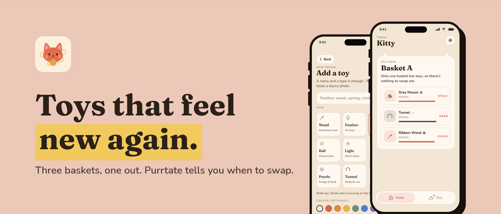
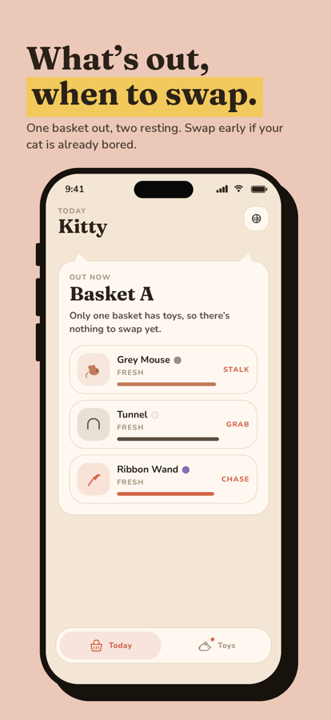
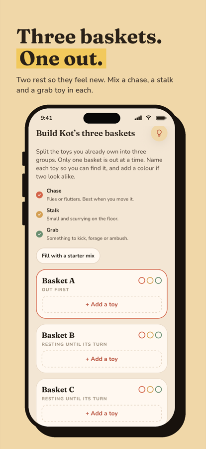
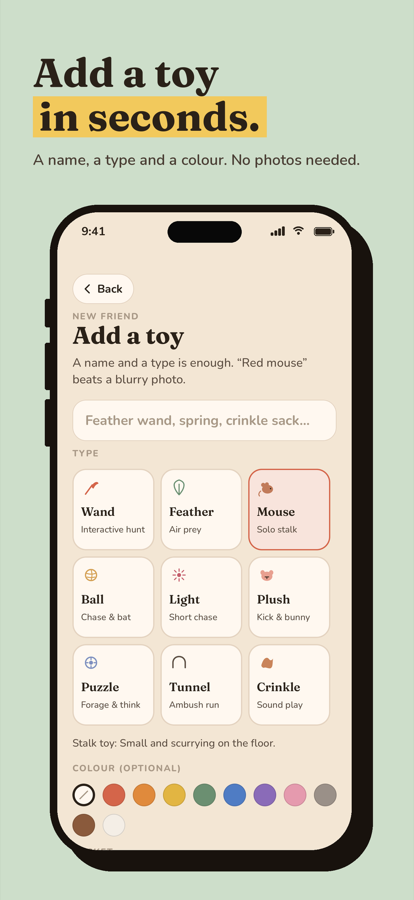
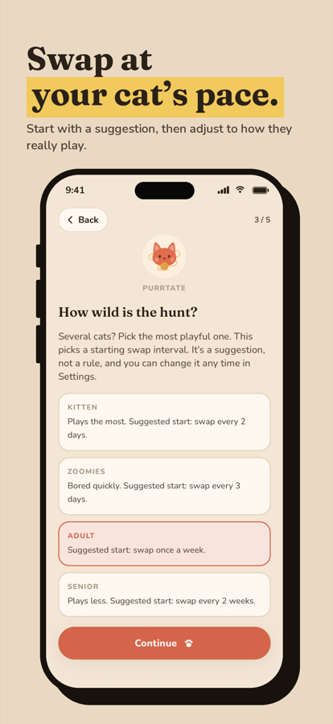
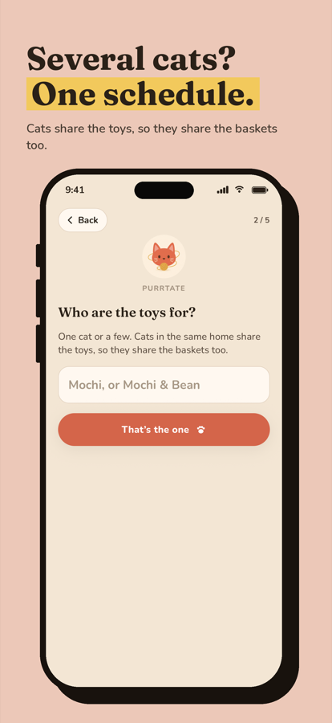
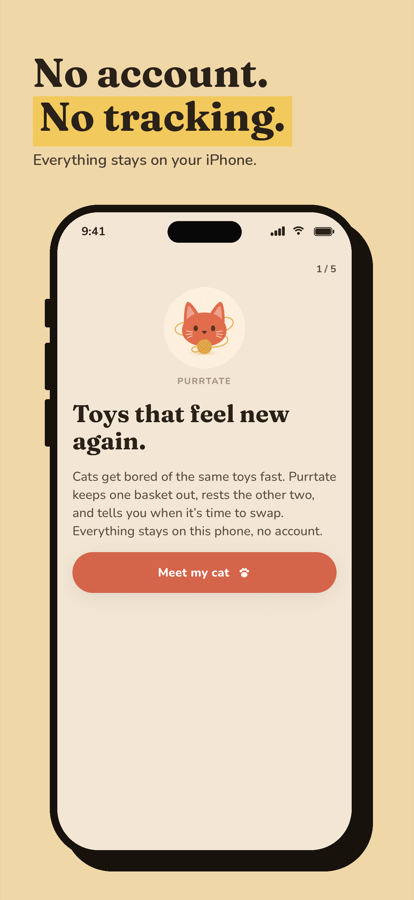

<p align="center">
  
</p>

<h1 align="center">Purrtate</h1>

<p align="center">
  <b>Toys that feel new again.</b><br />
  An iPhone app that rotates your cat's toys across three baskets and tells you when to swap.
</p>

<p align="center">
  
</p>

## Why

Cats lose interest in toys they see every day. Putting toys away for a while and bringing them back makes them interesting again. Purrtate turns that into a simple routine. Toys go into three baskets. One basket is out and the other two rest. On swap day the next basket comes out.

## Screenshots

<p align="center">
  
  
  
</p>
<p align="center">
  
  
  
</p>

## Features

- **Three baskets, one out.** Today shows which basket is out, which toys are in it, how many days are left and what comes out next.
- **Swap interval set by energy level.** Energy presets set the interval (2 to 14 days), and you can change it yourself. If you keep swapping early, the app offers a shorter interval.
- **Basket advice.** A "!" next to a basket warns when it has too few toys or no chase, stalk or grab toy. The app also suggests getting a new toy every few weeks.
- **Guided setup.** One tip per screen, then you build the baskets. A lamp button brings the tips back while you build.
- **Swap-day reminder.** One local notification on swap day. No server needed.
- **Private by design.** No account, no analytics and no network requests. All data stays on the iPhone.

See [docs/toy-rotation-research.md](docs/toy-rotation-research.md) for the research behind the rules and how reliable the numbers are.

## Tech stack

| | |
|---|---|
| App | Expo SDK 57, React Native 0.86, TypeScript |
| Navigation | expo-router |
| State | Zustand 5 + AsyncStorage persistence (versioned, migrated, sanitized on load) |
| Notifications | expo-notifications (local, date trigger) |
| Tests | Jest + jest-expo |
| Build & release | EAS Build / Submit |

## Project structure

```
app/            screens (expo-router): onboarding, Today and Toys tabs, settings, toy editor
components/     UI: basket builder, tips, toy cards, tab bar, icons
lib/            rotation logic, toy advice, presets, input sanitizing, reminders
store/          Zustand store with persistence and migrations
plugins/        Expo config plugin (iOS UIScene lifecycle)
__tests__/      unit tests for rotation, advice, sanitizing and the store
docs/           privacy, terms, support and impressum (GitHub Pages)
appstore/       scripts that generate the App Store screenshots and artwork
```

## Getting started

```sh
npm install
npx expo run:ios            # simulator
npx expo run:ios --device   # connected iPhone
```

## Scripts

```sh
npm test               # unit tests
npm run typecheck      # TypeScript
npm run release:ios    # EAS production build + submit to App Store Connect
```

App Store images are generated from the screenshots in `appstore/source/`:

```sh
python3 appstore/make_screenshots.py   # 6.9" and 6.3" screenshots
python3 appstore/make_banners.py       # header and search result artwork
```

## Links

- [Privacy Policy](https://ma6di.github.io/Purrtate/privacy.html)
- [Terms of Use](https://ma6di.github.io/Purrtate/terms.html)
- [Support](https://ma6di.github.io/Purrtate/support.html)

---

© 2026 Mahdi Cheraghali
